# UX results (Phases 3 and 4)

Run on 25 October 2026 against `server.js` with `STORAGE=local`, Chromium (Playwright), at
1440×900 with a mouse and keyboard and at 375×812 as a touch phone. Every line below was
observed, not assumed. Before shots are from the audit (UX-AUDIT.md), taken on the same data.

## In short

- **Built for one person first.** A new **"Just me"** mode (Settings → How you work) gives a
  freelancer a short menu (Work, Clients, Plan, Business), calls People "Partners", and takes
  team-only cards off the dashboard. "Decide for me" (the default) switches to it while there is
  at most one active non-partner person. Every team screen still exists and opens by its address.
- **Looks like the portfolio site.** The default look now uses the portfolio's paper
  background, ink, cerulean blue (#3B84B1), navy (#1A3647) and blue mist (#C9DDE9), with 2 px ink
  outlines, hard offset shadows and bold uppercase page titles, in Figtree like the site.
  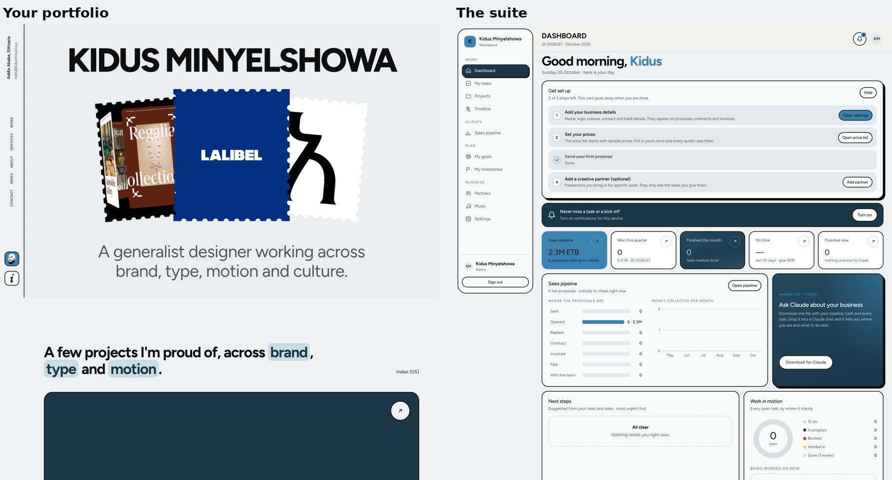
- **Your brand everywhere.** One accent and one highlight colour from Brand & region now colour
  the Team app, the Price Builder, the client proposal ("Your brand" theme, the default for new
  quotes) and the PDFs. Text on the accent turns white or near-black, whichever is readable.
- **A first-run checklist** on the admin dashboard: business details, prices, first proposal,
  and (optional) a creative partner or the team. It ticks itself and can be hidden.
- **Empty lists say what to do next** with a button (quotes, sales pipeline, projects, tasks,
  goals).
- **Week-by-week project timeline per service**, like the WEMMA proposal: steps and client
  reviews per service in the Price Builder, a chart on the client page and a page in the PDF.
  It follows the delivery pace the client picks.

## The four main screens

| Screen | Before / after |
| --- | --- |
| Dashboard ("Just me") | 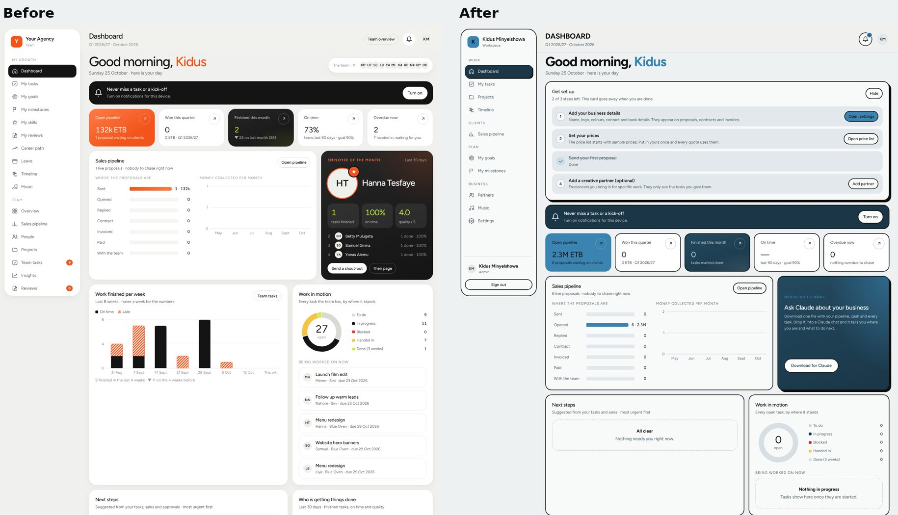 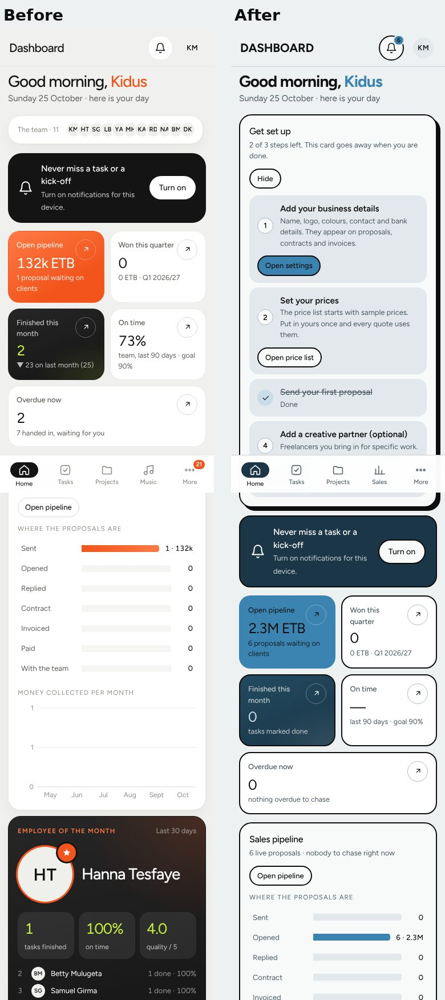 |
| Dashboard (with a team) | 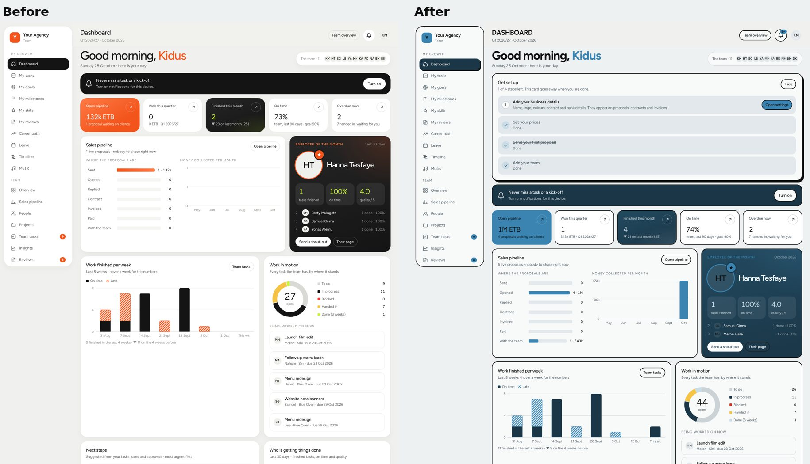 |
| Task board | 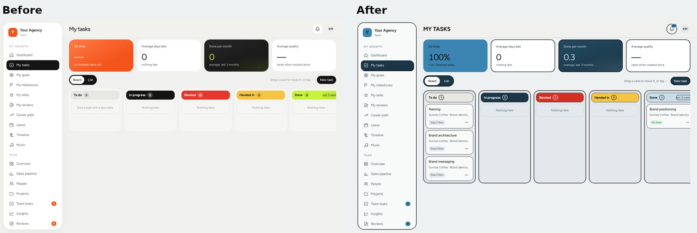 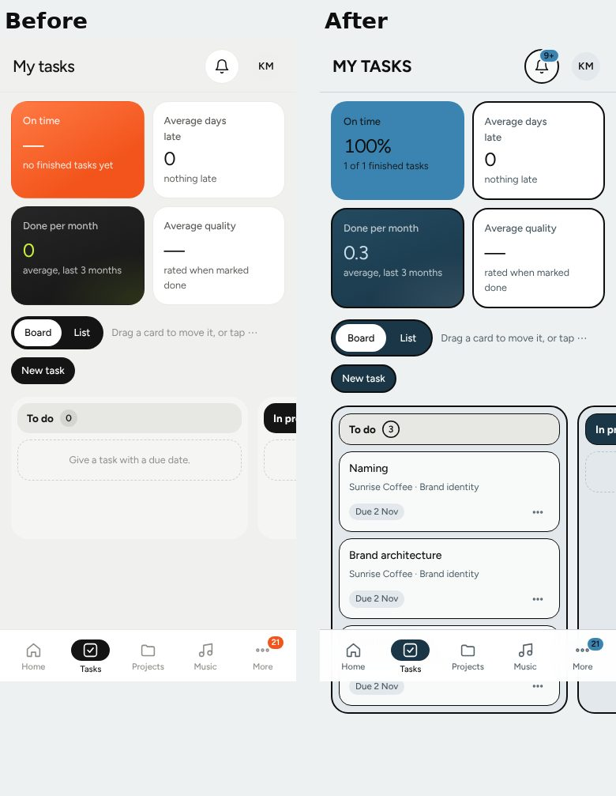 |
| Price Builder | 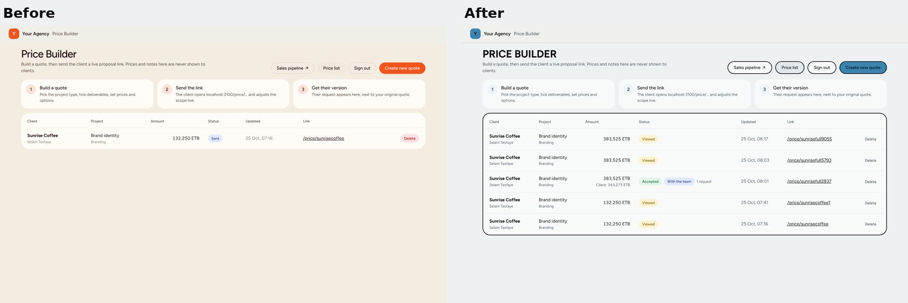 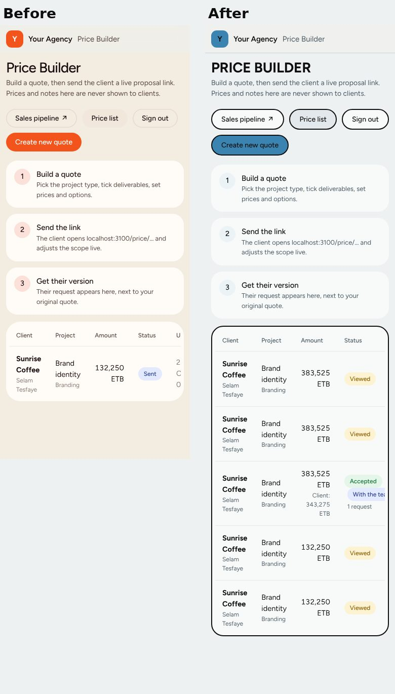 |
| Client proposal | 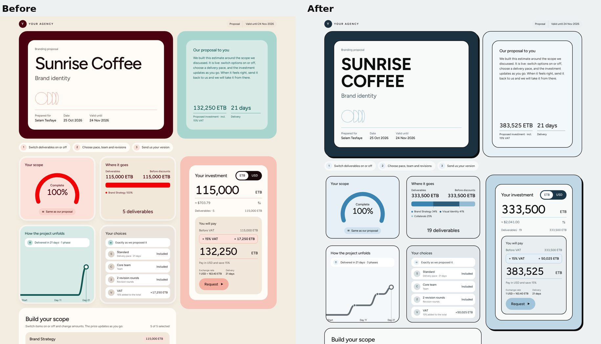 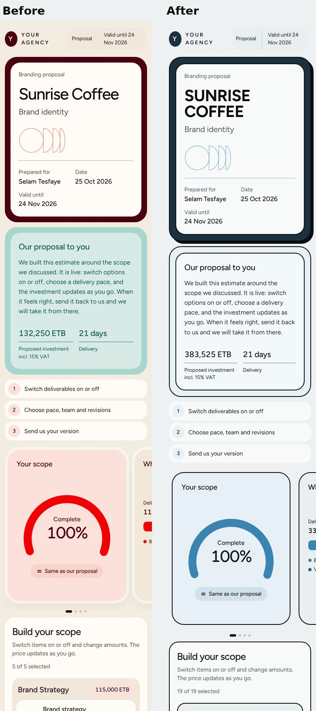 |

Project timeline: 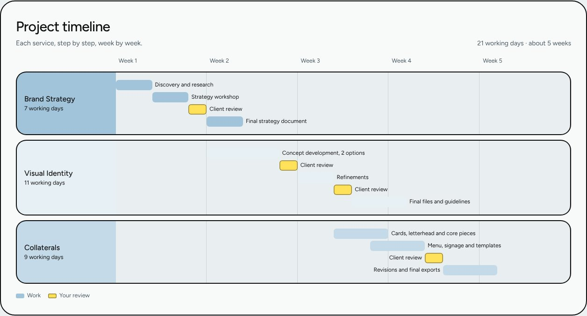 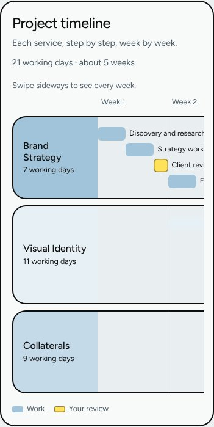
Step editor in the Price Builder: 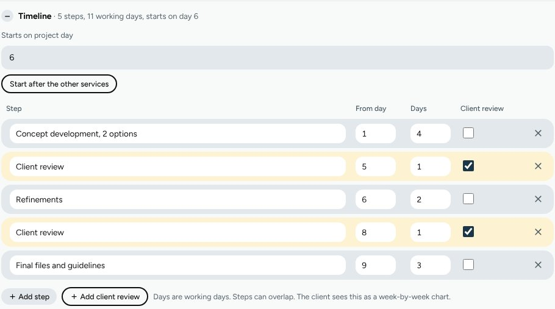
PDF page: 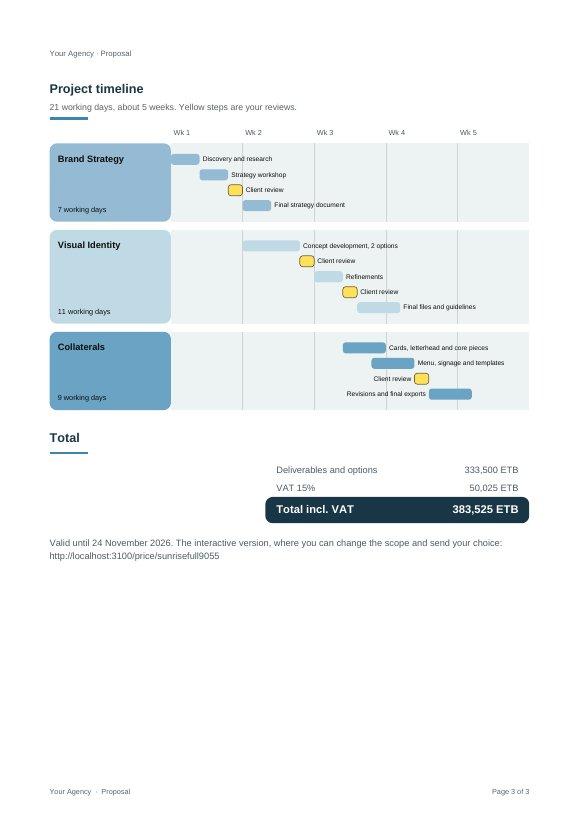

## Walkthrough, every role, both sizes

Signed in as each role and opened its screens; checked page errors, sideways scrolling, text
contrast (WCAG AA: 4.5:1, 3:1 for large text), controls smaller than 24 px, buttons without a
name, and, on desktop, whether focus is visible over six Tab presses.

| Role | Screens | 1440 | 375 (touch) |
| --- | --- | --- | --- |
| Admin | dashboard, tasks, projects, sales, people, settings, goals | no errors, no sideways scroll, contrast passes, focus 6/6 | no errors, no sideways scroll, contrast passes |
| Manager | dashboard, tasks, projects | same | same |
| Employee | dashboard, tasks | same | same |
| Creative partner | dashboard, tasks | same | same |
| Price Builder | quotes, new quote, price list | same; 3 small items are text links inside the table | same; every input at least 44 px tall and 84 px wide |
| Client | proposal page | same; 19 switches measure 23 px but have a larger invisible tap area | same |

Found and fixed by this walkthrough: the "Blocked" column and its count (4.27:1 and 3.16:1),
the leaderboard's first rank (3.47:1), the timeline's day labels (3.54:1), cramped price-list
inputs on phones (23 px wide), duplicate "1, 1" labels on an empty money chart, focus rings that
drew square corners, and a page error when the Team app routed while signed out.

## Two very different brands

| Brand | Accent / highlight | Team app | Proposal page | PDF |
| --- | --- | --- | --- | --- |
| Kidus (default) | #3B84B1 cerulean / #C9DDE9 blue mist | re-themed, contrast passes | re-themed, contrast passes | blue accents, navy headings and total |
| Fern & Field | #0B5D3B dark green / #F4D35E yellow | re-themed, contrast passes | re-themed, contrast passes | green mark, rules, table heads and timeline; text on green readable |
| Pop Kiosk | #FF2E88 hot pink / #2EC4F1 cyan | re-themed, contrast passes (dark text on pink picked automatically) | re-themed, contrast passes | pink throughout, readable |

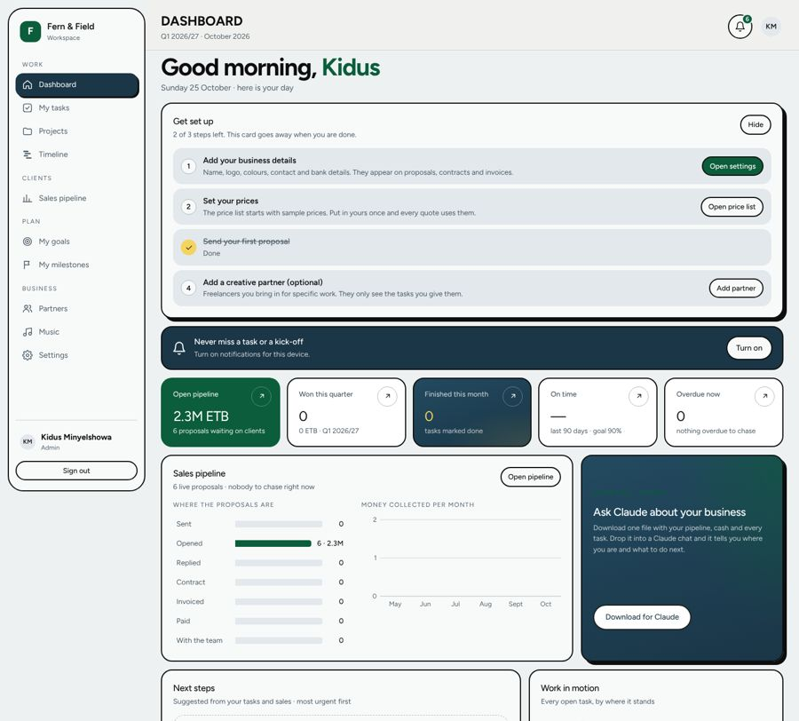 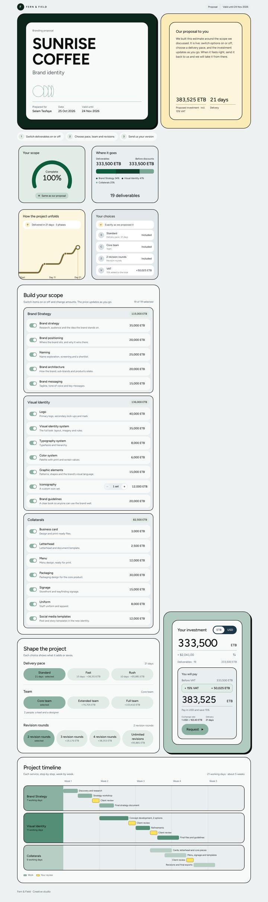 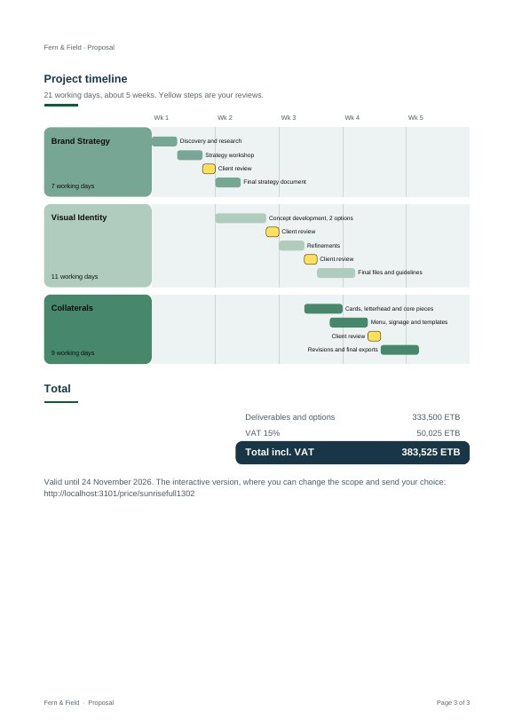
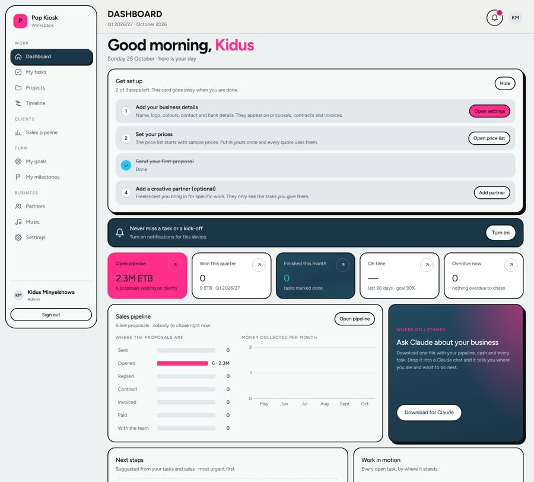 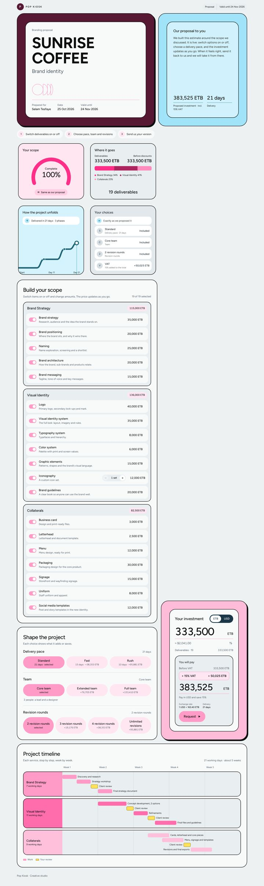 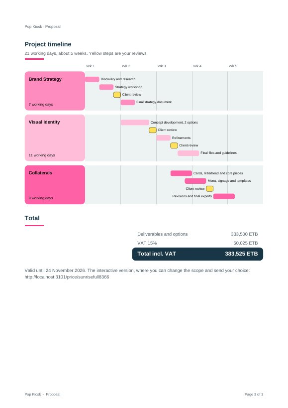

## Features from TEST-RESULTS, checked again

| Check | Result |
| --- | --- |
| Fresh install, setup, sign-ins, preset save, leads import, price list, quotes list, photo upload and read back, `/media` refuses documents, three crons with the secret, second setup refused | 22 of 22 |
| New quote (Branding, all three services, "Your brand" theme), client link | created; timeline shows three services over 21 working days |
| Delivery pace Fast / Rush on the client page | timeline 15 and 10 days (scaled from 21, matching the pace options) |
| Service with every item switched off | left out of the timeline |
| Client switches an item off and sends a request | sent; shows on the quote |
| Contract from the request, PDF, mark signed | CTR-2026-001, 12.6 KB PDF, signed |
| Deposit invoice, PDF, mark paid | INV-2026-0001, paid |
| Kick off, then start the project in Team | project created; 18 tasks; task moved to in progress, handed in, done |
| Proposal PDF with the timeline page | 3 pages; "Project timeline" with Wk 1–5 and every step |
| Task given, handed in, done and rated 4/5; International preset and back to Ethiopia | pass |

## Font licence

Figtree (SIL Open Font License 1.1), loaded from Google Fonts. Free for commercial use; no
change needed. The PDFs use the built-in Helvetica.

## Not done, and doubts (nothing was deleted)

- The plan put the tokens in `public/suite.css`; they live in `public/team/suite.css` so the
  Price Builder and proposal can load them from the same place the Team app already serves.
- People and milestones keep their plain "nothing here" text rather than a next button.
- Screens a freelancer may never need but which were kept and are only hidden from the menu in
  "Just me" mode: Overview, Team tasks (shown as Partner tasks when partners exist), Insights,
  Reviews, Team goals, Leave requests, Reports, Approvals, Skills, Career path, Leave.
  Settings → "Team structure and reviews" is folded shut when working alone.
- The Classic, Blossom, Ember, Sage and Cobalt proposal themes stay as fixed palettes.
- Not tested here: a real phone (touch was emulated), screen readers, Safari and Firefox.
